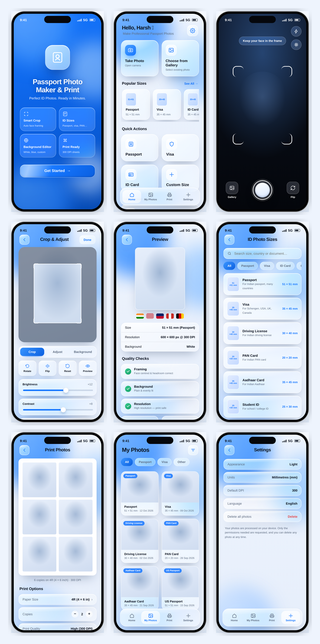

# Passport Photo Maker & Print — Liquid Glass

A premium, production-quality UI prototype for a **Passport Photo Maker & Print** iOS app, built in Apple's **Liquid Glass** design language — translucent glass surfaces, frosted blur, layered depth, soft specular highlights and fluid spring animations.

Everything lives in a single self-contained **`index.html`** — no build step, no dependencies, no framework. Open it and it runs.



---

## ✨ What's inside

**9 screens, fully navigable:**

| # | Screen | Highlights |
|---|--------|-----------|
| 1 | Welcome / Onboarding | Full-bleed blue gradient, floating glass layers, feature grid, glossy CTA |
| 2 | Home Dashboard | Action cards, popular sizes rail, quick actions, floating glass tab bar |
| 3 | Camera Capture | Dark viewfinder, face-guide brackets, glossy glass shutter ring, flash + flip |
| 4 | Crop & Adjust | Crop frame, segmented glass toolbar, working brightness/contrast/saturation sliders, background swatches |
| 5 | Preview | Final photo, quality checks, spec sheet, Edit / Save / Export / Share / Save & Print |
| 6 | ID Photo Sizes | Live search + filter tabs, presets with real dimensions, custom size |
| 7 | Print Studio | Sheet preview, paper size, copies stepper, quality/colour, Print + Save PDF |
| 8 | My Photos | Glass gallery grid, filters, badges, empty state |
| 9 | Settings | Appearance, units, DPI, language, delete control |

## 🧊 The Liquid Glass system

- **Frosted translucent surfaces** via `backdrop-filter: blur(26px) saturate(185%)`
- **Luminous hairline borders** + inset specular highlights on every panel
- **Animated colour orbs** drifting behind the glass — this is what gives it the "liquid" feel
- **Glossy primary buttons** with a moving sheen sweep on hover
- **Floating pill navigation** and spring-based press feedback
- **Light & dark mode** — toggle in the top-right
- **Graceful fallback** — content stays readable where blur is unsupported

## ▶️ Run it

```bash
# just open the file
open index.html          # macOS
xdg-open index.html      # Linux
# or serve it
python3 -m http.server 8000
```

Keyboard: **← / →** move between screens. Tap anything — buttons navigate, sliders move, toasts fire.

## 🖼️ Previews

Full-resolution renders of every screen are in [`previews/`](previews/):

- `01-welcome.png` … `09-settings.png` — each screen
- `10-home-dark.png` — dark mode
- `all-screens.png` — combined contact sheet

## 🛠️ Tech

Plain **HTML + CSS + vanilla JavaScript**. No build, no npm, no framework. Uses system SF-style typography, CSS custom properties for theming, and a tiny amount of JS for navigation and interactive state.

## ⚠️ Note

This is a **design prototype**. Photo sizes shown are layout references — always confirm the current official requirements for any document before printing. Not affiliated with Apple; the design is inspired by Apple's visual language and copies no proprietary assets.
