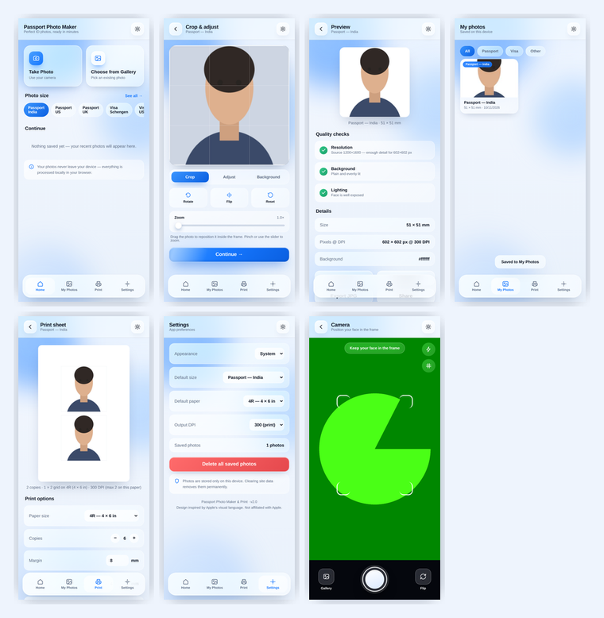

# Passport Photo Maker & Print

A working, installable web app that makes passport, visa and ID photos on your device — real camera capture, cropping, colour adjustments, background replacement, saved-photo library, and a print-ready sheet exported as high-resolution JPEG or PDF.

Everything runs **locally in the browser**. No uploads, no accounts, no server.



---

## What actually works

This is a functioning application, not a mockup. Every control is wired to real image processing:

| Feature | How it works |
|---|---|
| **Camera capture** | `getUserMedia` live viewfinder with face-alignment guides, front/rear switch and torch where supported |
| **Gallery import** | File picker + `createImageBitmap` with EXIF orientation handling, so phone photos aren't sideways |
| **Crop & frame** | Drag to reposition, zoom 1–4×, rotate 90°, flip — locked to the exact aspect ratio of the chosen document |
| **Adjustments** | Brightness, contrast and saturation applied through the canvas filter pipeline, plus a one-tap auto-enhance |
| **Background replacement** | Flood-fill from the border with a dominant-colour seed and a feathered edge — repaints the wall behind you in white, blue or any colour |
| **ID photo sizes** | Real millimetre → pixel maths at your chosen DPI (e.g. 51 × 51 mm @ 300 DPI = 602 × 602 px) |
| **Quality checks** | Genuine measurements: source resolution vs output (upscaling detection), side-margin background uniformity, and face-area exposure |
| **Saved library** | IndexedDB store with thumbnails, filters, download, share and delete |
| **Print sheet** | Composes N copies onto 4R / A4 / Letter at 300 DPI with adjustable margin, spacing and cut guides |
| **PDF export** | A dependency-free PDF writer that embeds the sheet JPEG as a `DCTDecode` image XObject |
| **Share / print** | Web Share API with files, and the system print dialog |
| **Offline / installable** | Service worker caches the shell; a web app manifest makes it installable to the home screen |
| **Light & dark** | Follows the system theme, or force either from Settings |

## ▶️ Running it

The camera needs a **secure context** — `https://` or `localhost`. Opening `index.html` from the filesystem (`file://`) will run everything *except* the live camera, so serve it locally instead:

```bash
cd passport-photo-maker
python3 -m http.server 8000
# then open http://localhost:8000
```

The published version runs over HTTPS on GitHub Pages, so the camera works there too.

## 📁 Layout

```
index.html               the app
css/app.css              liquid-glass design system
js/app.js                camera, editor, background removal, sheet composer, PDF writer
manifest.webmanifest     PWA manifest
sw.js                    offline service worker
icons/                   app icons (192, 512, maskable)
showcase.html            the original 8-screen design study (self-contained)
previews/                renders of the design study
previews/app/            screenshots of the working app
```

## 📐 Sizes included

Passport (India 51×51 mm, US 2×2 in, UK 35×45 mm) · Visa (Schengen, US, Canada) · Driving licence · PAN card · Aadhaar · Student ID · Custom (any width, height and DPI).

Dimensions are provided as layout references. **Always confirm the current official requirements for your document** — specifications change, and this app does not claim official compliance.

## 🧊 Design

The interface uses a Liquid Glass language: frosted translucent panels with `backdrop-filter`, hairline luminous borders, inset specular highlights, animated colour orbs drifting behind the glass, glossy primary buttons and floating pill navigation. Inspired by Apple's visual language; not affiliated with Apple and copying no proprietary assets.

## ⚠️ Honest limitations

- **Background replacement** is a colour-based flood fill, not machine learning. It works well against a plain, evenly lit wall and will struggle with busy or multi-coloured backgrounds. There is a tolerance slider to tune it.
- **Quality checks are heuristics**, not face detection — they measure resolution, exposure and background uniformity.
- **Camera capture** depends on browser and device support; the app degrades to the gallery picker when a camera isn't available.
- **Print output** is a raster sheet at 300 DPI. Actual print quality depends on your printer and paper.

## 🛠️ Tech

Plain HTML, CSS and JavaScript — no framework, no build step, no dependencies.
